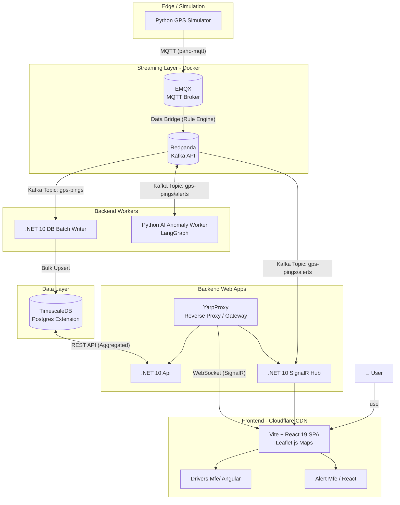

# FleetPulse System

FleetPulse is a local-development demonstration of a real-time fleet operations control tower. A Python simulator publishes delivery-vehicle GPS telemetry; streaming and backend services process it, persist fleet state, identify working-zone violations, and deliver live updates to a web interface.

The repository is a polyglot monorepo containing .NET, Python, React, and Angular applications. The root README is an entry point; detailed architecture and implementation notes are linked below.

## What the system demonstrates

- MQTT ingress through EMQX and Kafka-compatible event streaming with Redpanda.
- Independent consumers for live SignalR updates, database ingestion, and AI-assisted alerts.
- PostgreSQL with TimescaleDB for fleet state and telemetry data.
- A .NET REST API behind a YARP reverse proxy, alongside a .NET SignalR hub.
- A React SPA with separately built React and Angular micro-frontends.
- Local metrics, logs, and traces using Prometheus, Grafana, Loki, Promtail, Tempo, and OpenTelemetry.

## Architecture at a glance

Telemetry flows from the simulator through MQTT/EMQX to Redpanda. The DB writer persists data, the SignalR hub broadcasts real-time events, and the AI worker can publish enriched alerts. The frontend accesses REST and SignalR through the YARP proxy.



For the complete overview, see [Architecture](docs/architecture.md) and the [C4 model source and rendered diagrams](docs/c4model/).

## Services

| Component | Purpose | Detailed guide |
| --- | --- | --- |
| GPS simulator | Generates vehicle routes and publishes telemetry to the MQTT broker. | [Simulator source](simulator/) |
| EMQX | Accepts MQTT telemetry and bridges it to Redpanda. | [Docker composition guide](docker/README.md) |
| Redpanda | Kafka API-compatible stream used to fan out telemetry and alerts. | [Architecture](docs/architecture.md) |
| Database writer | Consumes stream events and persists telemetry/state to TimescaleDB. | [DB writer guide](docs/services/db-writer.md) |
| AI worker | Detects working-zone violations and publishes AI-assisted alert assessments. | [AI worker guide](docs/services/ai-worker.md) |
| SignalR hub | Handles authenticated live connections, session login, and telemetry/alert broadcasts. | [SignalR hub guide](docs/services/signalr-hub.md) |
| FleetPulse API | Serves driver and alert REST endpoints; Drivers and Alerts are in-process modules. | [API guide](docs/services/api-service.md) |
| YARP proxy | Routes frontend REST and SignalR traffic to the API and hub. | [Architecture](docs/architecture.md) |
| Frontend and micro-frontends | React SPA for live fleet views, with alert-management and driver-management modules. | [Frontend guide](docs/services/frontend.md) |
| Observability stack | Collects and visualizes metrics, logs, and traces for local development. | [Observability guide](docs/observability.md) |

The Compose setup also includes supporting services such as TimescaleDB, Prometheus, Grafana, Loki, Promtail, Tempo, and the OpenTelemetry Collector. A mock SignalR service is available for UI testing; see [Docker composition files](docker/README.md).

## Run the full local stack

The aggregate Compose file runs the application and supporting containers on a private bridge network. The simulator is run separately on the host. This is a development/demo configuration, not a production deployment recipe.

### Prerequisites

- Docker Desktop with Docker Compose.
- PowerShell to use the provided image-build scripts.
- Python 3 and pip to run the simulator on the host.
- Azure OpenAI configuration and credentials if running the AI worker with live model analysis.

### Prepare configuration and images

1. Copy [docker/env_sample.txt](docker/env_sample.txt) to `docker/.env`. Replace the sample database, local authentication, Grafana, and AI-provider values as needed. Do not commit real secrets.
2. From the repository root, build the service images referenced by Compose:

    ```powershell
    .\build-images.ps1
    .\build-frontend.ps1
    ```

    The aggregate Compose file expects these images to exist locally before starting.
3. Start the aggregate stack from the repository root:

    ```powershell
    docker compose -f .\docker\docker-compose-aggregated.yml up -d
    ```

4. Open the frontend at [http://localhost:5173](http://localhost:5173). The YARP entry point is [http://localhost:8580](http://localhost:8580); supporting interfaces include [Grafana](http://localhost:3000), [Prometheus](http://localhost:9090), and the [EMQX dashboard](http://localhost:18083). Check [Docker composition files](docker/README.md) for the full set of services and ports.

### Run the simulator

The simulator entry point loads configuration from `simulator/src/fleetpulse/.env`. Copy `simulator/src/.env.sample.txt` there and set `MOCK_MODE=False` to publish to the local EMQX broker instead of using the mock publisher. The sample enables OTLP tracing; leave it enabled only when the local tracing stack is running, or disable it for a simulator-only run.

From the repository root:

```powershell
python -m pip install -r .\simulator\src\requirements.txt
python .\simulator\src\fleetpulse\main.py
```

Stop the containers from the repository root with:

```powershell
docker compose -f .\docker\docker-compose-aggregated.yml down
```

Add `-v` only when you also want to remove persisted Compose data volumes.

For individual Compose groups and their separate external-network setup, see [docker/README.md](docker/README.md).

## Documentation

- [System architecture](docs/architecture.md)
- [C4 model files and diagrams](docs/c4model/)
- [Data contracts](docs/data-contracts.md)
- [Observability](docs/observability.md) and [Prometheus details](docs/prometheus.md)
- [CI workflows](docs/ci.md)
- [Architecture Decision Records](docs/adr/)
- [Service documentation](docs/services/)

## Development and tests

The services can be developed and tested independently. Build and test commands vary by application and are covered by the service documentation and [CI workflow guide](docs/ci.md). The CI workflows run frontend, .NET, and Python checks separately.

## Notes

- The aggregate Compose stack uses `fleetpulse_network`. The standalone Compose files use an external `redpanda_network`; follow [docker/README.md](docker/README.md) when using those files.
- Compose service images are built locally by the PowerShell scripts; `docker compose up` alone does not build all application images.
- Set credentials and secrets in local environment configuration or an appropriate secret store. Never use sample credentials outside local development.

