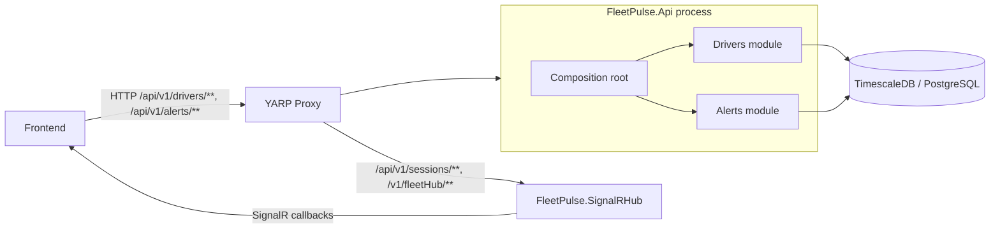

# FleetPulse.Api

`FleetPulse.Api` is the REST/HTTP service for FleetPulse. It is an ASP.NET Core 10 Minimal API hosted behind YARP. Its single composition root hosts two in-process modules, Drivers and Alerts; it is a modular monolith, not two independently deployed services.

The API reads driver state, GPS history, and alerts from TimescaleDB/PostgreSQL through Dapper and Npgsql. Real-time pushes and session login remain in `FleetPulse.SignalRHub`.

## Architecture



The host owns shared HTTP concerns: authentication/authorization, CORS, OpenTelemetry, Prometheus metrics, structured logging, exception handling, health checks, and database version reporting. It registers the module APIs and their Mediator handler assemblies. The module projects are grouped under `Drivers/` and `Alerts/`; each has `Api`, `Application`, `Contracts`, `Domain`, `Infrastructure`, `Public`, and `Tests` projects.

Project dependency rules are directed and module-local: Domain has no project dependencies; Application depends on its own Domain and Public; Infrastructure depends on its own Application and Domain; Api depends on its own Application, Contracts, Domain, and Infrastructure. The host references each module's Api project. No module references the other module's Application, Domain, or Infrastructure. `Contracts` contains HTTP response DTOs; `Public` is reserved for cross-module ports/events and is currently empty. Common validation code is duplicated per module; there is no Shared.Kernel project.

Both modules currently query tables in the shared `fleetpulse` database schema. The planned `drivers`/`alerts` schema separation has not been applied because the schema script is also used by the SignalR hub.

## HTTP endpoints

The default API version is `v1` (`AppSettings:ApiVersion`). YARP sends driver and alert paths to this service and sends sessions and the SignalR hub path to the SignalR service.

| Method | Path | Auth | Query parameters | Behavior |
|---|---|---|---|---|
| GET | `/` | No | — | Returns `FleetPulse API`. |
| GET | `/health` | No | — | Liveness response `Healthy`. |
| GET | `/healthz` | No | — | ASP.NET Core health checks, including PostgreSQL. |
| GET | `/dbversion` | Yes | — | Returns PostgreSQL's `version()` string. |
| GET | `/api/v1/drivers` | Yes | `from` (required), `to` (optional) | Returns latest driver states where `last_seen > from`. `to` is accepted but currently not applied by the query. |
| GET | `/api/v1/drivers/{id}/history` | Yes | `from`, `to` (required) | Returns GPS history for the driver between the supplied timestamps. |
| GET | `/api/v1/alerts` | Yes | `pagesize`, `pagenumber` (required); `status`, `riskLevel`, `from`, `to` (optional) | Returns alerts filtered and ordered by `raised_at` descending. |
| GET | `/metrics` | No | — | Prometheus HTTP metrics. |

All endpoints in the `/api/v1` group require authorization. The `/dbversion` endpoint is also explicitly protected. OpenAPI is mapped in Development only.

### Response contracts

`GET /api/v1/drivers` returns an array of `LastestDriverStateResponse` objects:

```json
[
  {
    "driverId": "driver-123",
    "latitude": 37.7,
    "longitude": -122.4,
    "speed": 42.0,
    "heading": 90.0,
    "lastSeen": "2026-10-10T12:00:00.0000000+00:00",
    "status": "active"
  }
]
```

`GET /api/v1/drivers/{id}/history` returns an array of `GpsPingResponse` objects. The current query selects driver id, coordinates, speed, heading, and timestamp; fields such as event id, accuracy, and status are not returned.

`GET /api/v1/alerts` returns `PagedResponse<AlertResponse>` with `items`, `totalCount`, `pageNumber`, `pageSize`, `totalPages`, `hasPreviousPage`, and `hasNextPage`. Paging metadata is currently a parity stub (`totalCount` equals the returned item count, `totalPages` is 1, and both `has*` flags are false). Page size and page number are not validated yet; invalid enum text for `status` or `riskLevel` can fail during parsing.

## Authentication and authorization

Authentication configuration is under `Authentication` in `appsettings.json`. Supported `Authentication:Mode` values are `local`, `msal`, and `both`. In `both` mode, the `Smart` policy scheme inspects the bearer token issuer and forwards Entra ID issuers to the Entra handler; other bearer tokens use local JWT validation.

- Local validation uses `Authentication:Local:Jwt:Secret`, `Issuer`, and `Audience`.
- Entra ID validation uses `Authentication:EntraId:TenantId` and `ClientId`; scheme names are configurable and must differ in `both` mode.
- The `FleetUser` policy requires the `scope` claim to contain `access_as_user`; `FleetAdminOnly` requires the `Fleet.admin` role. Endpoints can opt into these policies explicitly.
- The API validates local JWTs; it does not issue them or host `/api/v1/sessions`. Local session login and token issuance belong to the SignalR hub. Keep signing secrets in user secrets or deployment/environment secrets, not in checked-in settings.

## Configuration and local operation

The API uses `ConnectionStrings:FleetPulseDb`, `Cors:AllowedOrigins`, `OpenTelemetry:OtlpEndpoint`, and `AppSettings` (`AppName`, `AppVersion`, `ApiVersion`). The same database and authentication values are shared with the SignalR hub. The checked-in configuration intentionally does not contain production credentials.

The API Dockerfile expects the `FleetPulse.Api/` solution directory as its build context. The `fleetpulse-api` compose service listens on container port 8080; YARP routes to `http://fleetpulse-api:8080/`. Integration tests live in `Drivers/FleetPulse.Drivers.Tests` and `Alerts/FleetPulse.Alerts.Tests`; they use Testcontainers and the shared `db/init.sql` schema and therefore require Docker.

## Related services

- [SignalR hub](signalr-hub.md) handles session login, SignalR connections, and Kafka-backed real-time notifications.
- `FleetPulse.YarpProxy` is the single public HTTP/WebSocket entry point and routes API and hub paths to their respective services.
- [ADR 0021](../adr/0021-split-api-into-two-modules-modular-monolith-arch.md) records the modular-monolith decision and implementation deviations.

