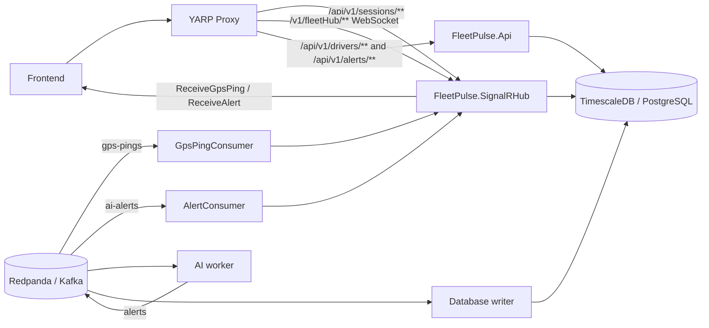

# FleetPulse.SignalRHub

`FleetPulse.SignalRHub` is the ASP.NET Core 10 SignalR and Kafka-consumer service. After the REST migration, it no longer serves driver or alert query endpoints. The REST API is handled by [`FleetPulse.Api`](api-service.md).

The hub's responsibilities are:

- Accept authenticated SignalR connections and broadcast live GPS pings and alerts.
- Consume GPS and AI alert messages from Redpanda/Kafka using hosted background services.
- Expose the anonymous session-login endpoint that issues local access tokens and refresh tokens.
- Provide basic health checks and the protected database-version endpoint.

## Architecture and routing



YARP is the frontend's single entry point. It routes session requests to the hub, driver/alert REST requests to `FleetPulse.Api`, and `/v1/fleetHub` WebSocket traffic to the hub. The hub and REST API are separate deployables and both connect to the shared `fleetpulse` database schema.

## HTTP and SignalR endpoints

| Method | Path | Auth | Purpose |
|---|---|---|---|
| GET | `/` | No | Returns `Welcome to SignalR Hub`. |
| GET | `/health` | No | Liveness response. |
| GET | `/healthz` | No | Health checks, including PostgreSQL and the Kafka consumer check. |
| GET | `/dbversion` | Yes | Returns the connected PostgreSQL version string. |
| POST | `/api/v1/sessions` | No | Validates configured local credentials and issues a token response. |
| SignalR | `/v1/fleetHub` | Yes | Authenticated real-time connection. |

The hub does not map `GET /api/v1/drivers`, driver history, or `GET /api/v1/alerts`; those routes belong to `FleetPulse.Api`.

### Session login

`POST /api/v1/sessions` accepts a `LoginRequest` with username and password. FluentValidation requires both values. In local mode, the configured default credentials are used for authentication. The successful response contains an access token, username, expiry information, and refresh-token fields. Local access tokens are validated by the hub and API using the shared local JWT issuer, audience, and secret configuration.

## SignalR callbacks and groups

`SignalR:GpsPingCallbackMethod` and `SignalR:AlertCallbackMethod` configure the callback names; current defaults are `ReceiveGpsPing` and `ReceiveAlert`.

`GpsPingConsumer` and `AlertConsumer` depend on `IRealTimeNotifier`. `RealTimeNotifier` uses `IHubContext<FleetHub>` to send GPS pings and alerts to all connected clients. Alert entities are mapped to the `AlertResponse` contract before broadcast; GPS pings are sent as the `GpsPing` model.

`FleetHub` provides `SubscribeFleet(fleetId)` and `UnsubscribeFleet(fleetId)` for joining and leaving the `fleet:{fleetId}` SignalR group. The current Kafka consumers broadcast to all connected clients; they do not use those groups for targeted sends.

```js
const connection = new signalR.HubConnectionBuilder()
  .withUrl("/v1/fleetHub")
  .build();

connection.on("ReceiveGpsPing", (ping) => { /* update GPS state */ });
connection.on("ReceiveAlert", (alert) => { /* update alert state */ });

await connection.start();
await connection.invoke("SubscribeFleet", "fleet-42");
```

The GPS callback payload includes `event_id`, `driver_id`, latitude, longitude, speed, heading, accuracy, status, and timestamp. The alert callback payload is `AlertResponse` with alert id, driver id, event coordinates, exit information, zone, risk level, assessment, recommendation, escalation flag, status, and raised time.

## Kafka consumers

The hub consumes Kafka-compatible topics from Redpanda. `GpsPingConsumer` reads `Kafka:GpsPingsTopic` (currently `gps-pings`); `AlertConsumer` reads `Kafka:AlertsTopic` (currently `ai-alerts`). Messages are deserialized directly from JSON; they are not wrapped in a `MessageWrapper`.

GPS consumer input includes driver id, coordinates, `speed_kmh`, `heading_degrees`, `accuracy_meters`, status, optional vehicle type, and timestamp. The consumer maps this DTO to `GpsPing`, then forwards it through the notifier. The alert consumer maps alert messages to the hub's alert domain model and broadcasts them through the same notifier.

GPS updates are throttled per driver to at most 2 Hz (one event per 500 ms); updates arriving faster are dropped. The Kafka consumer health check reports the tracked consumer heartbeat state as part of `/healthz`.

## Authentication and authorization

Authentication configuration is under `Authentication` in `appsettings.json`. Supported modes are `local`, `msal`, and `both`. The `Smart` scheme examines the bearer-token issuer and forwards Entra ID tokens to the Entra handler; other tokens use local JWT validation. In `both` mode, the configured local and Entra scheme names must differ.

- Local token validation uses `Authentication:Local:Jwt:Secret`, `Issuer`, and `Audience`. Login defaults are configured under `Authentication:Local:Auth`.
- Entra validation requires `Authentication:EntraId:TenantId` and `ClientId`.
- `FleetUser` requires the `access_as_user` scope; `FleetAdminOnly` requires the `Fleet.admin` role. Endpoints or hub methods must explicitly require the corresponding policy/authorization.
- SignalR clients may send bearer tokens in the `access_token` query parameter for the hub connection. Use HTTPS externally and do not put tokens in URLs except for the SignalR transport requirement.

Supply credentials and signing secrets through environment variables, user secrets, or deployment secret stores; do not check them into source control.

## Configuration and operations

Important configuration sections:

| Section | Key settings |
|---|---|
| `ConnectionStrings` | `FleetPulseDb` |
| `Kafka` | `BootstrapServers`, `GroupId`, `GpsPingsTopic`, `AlertsTopic`, `AutoOffsetReset`, `EnableAutoCommit`, `StatisticsIntervalMs` |
| `SignalR` | `GpsPingCallbackMethod`, `AlertCallbackMethod` |
| `Authentication` | `Mode`, local JWT/auth settings, Entra tenant/client/scheme settings |
| `Cors` | `AllowedOrigins` |
| `OpenTelemetry` | `OtlpEndpoint` |
| `AppSettings` | `AppName`, `AppVersion`, `ApiVersion` |

The hub allows configured CORS origins with credentials for browser SignalR handshakes. Prometheus HTTP metrics are mapped at `/metrics`. Kafka consumers and SignalR live here; HTTP query endpoints and their integration tests live in the Drivers and Alerts modules of `FleetPulse.Api`.

## Related documentation

- [REST API service](api-service.md) — modular-monolith modules, REST endpoints, response behavior, and API configuration.
- `docs/architecture.md` — system-wide architecture and service relationships.
